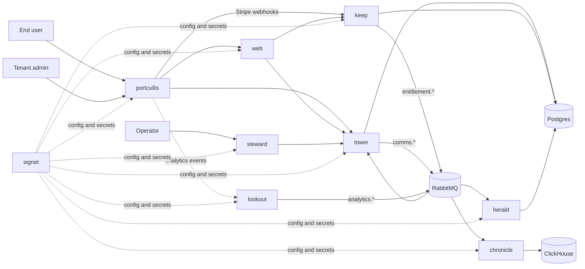

# System overview

authstar is a multi-tenant authentication, authorization, and billing platform. A tenant brings its own domain, identity providers, and Stripe account; authstar fronts the tenant's applications with a reverse proxy that authenticates users, enriches their session with roles, and forwards billing and analytics events to the services that own them.

The decisions behind every part are in [`../adrs/`](../adrs/README.md). The behaviour each component was built against is in [`../stories/`](../stories/), one folder per component. This page is the map; follow the links before changing a component.

## Parts

The dotted portcullis-to-lookout edge is designed but not implemented; see the state section below.

| Component | Path | What it does | Built with | Governing ADRs | Stories |
|-----------|------|--------------|------------|----------------|---------|
| portcullis | `portcullis/` | Reverse proxy and OIDC gate in front of every tenant application. Resolves the tenant from the host, runs the login flow, mints the ES256 internal JWT after tower enriches it, proxies branded pages to web, and forwards Stripe webhooks to keep. | Rust, axum | [ADR-0001](../adrs/0001-claims-enrichment-via-tower.md) [ADR-0002](../adrs/0002-multi-tenant-architecture-and-key-management.md) [ADR-0066](../adrs/0066-portcullis-proxies-branded-pages-to-web.md) [ADR-0086](../adrs/0086-jwks-endpoint-for-internal-jwt-verification.md) [ADR-0091](../adrs/0091-tenant-owned-domains-and-the-authstar-admin-surface.md) [ADR-0095](../adrs/0095-portcullis-forwards-stripe-webhooks-to-keep.md) | [proxy](../stories/proxy/) |
| tower | `tower/` | Identity and access: tenants, accounts, organizations, applications, role definitions, invites, API keys. Enriches sessions with roles and consumes keep's entitlement events. | Node, Fastify, consequent event sourcing on Postgres | [ADR-0003](../adrs/0003-enrichment-outcome-response-contract.md) [ADR-0018](../adrs/0018-trial-roles-and-keep-boundary.md) [ADR-0090](../adrs/0090-organizations-shared-billing-administration-and-succession.md) [ADR-0098](../adrs/0098-organization-permission-lifecycle.md) [ADR-0100](../adrs/0100-organization-membership-and-open-role-catalog.md) [ADR-0101](../adrs/0101-api-keys.md) [ADR-0103](../adrs/0103-spiffe-scoped-signet-writes-retire-admin-tokens.md) | [tower](../stories/tower/) |
| keep | `keep/` | Billing: per-tenant Stripe configuration, checkout and portal sessions, plan mappings from Stripe prices to roles, trials, coupons, usage credentials, webhook handling, and entitlement events to tower. | Node, Fastify, consequent on Postgres, Stripe SDK | [ADR-0041](../adrs/0041-keep-api-surface.md) [ADR-0046](../adrs/0046-tenant-owned-stripe-configuration.md) [ADR-0065](../adrs/0065-portal-upgrade-flow.md) [ADR-0095](../adrs/0095-portcullis-forwards-stripe-webhooks-to-keep.md) | [keep](../stories/keep/) |
| herald | `herald/` | Communications: consumes `comms.*` events, decrypts payloads with its rotated keys, sends email, keeps retention. | Node, Fastify, consequent on Postgres | [ADR-0052](../adrs/0052-keep-herald-own-signet-access.md) [ADR-0084](../adrs/0084-herald-actor-boundary-corrections.md) | [herald](../stories/herald/) |
| lookout | `lookout/` | Stateless analytics ingestion: accepts client events over HTTP and publishes them to RabbitMQ. | Node, Fastify | [ADR-0058](../adrs/0058-analytics-event-shape-corrections.md) [ADR-0059](../adrs/0059-web-analytics-screens.md) | [lookout](../stories/lookout/) |
| chronicle | `chronicle/` | Analytics storage and reporting: consumes `analytics.*` into ClickHouse and serves auth-funnel, active-user, query, and export reports. | Node, Fastify, ClickHouse | [ADR-0058](../adrs/0058-analytics-event-shape-corrections.md) [ADR-0059](../adrs/0059-web-analytics-screens.md) [ADR-0060](../adrs/0060-activity-feed-and-revenue-summary.md) | [chronicle](../stories/chronicle/) |
| steward | `steward/` | Operator console: tenant search and creation, admin access, applications, role definitions, key rotation. Port-forward only, operator bearer token. | SvelteKit, client rendered | [ADR-0045](../adrs/0045-steward-operator-console.md) [ADR-0062](../adrs/0062-tenant-status-enforcement-and-reactivation.md) | [steward](../stories/steward/) |
| web | `web/` | Tenant admin app behind portcullis, hosted pages (OAuth provider select, signup), and embeddable Web Components for end users. | SvelteKit, Tailwind | [ADR-0049](../adrs/0049-web-admin-information-architecture.md) [ADR-0061](../adrs/0061-web-overview-screen.md) [ADR-0066](../adrs/0066-portcullis-proxies-branded-pages-to-web.md) [ADR-0071](../adrs/0071-self-service-widget-data-access.md) [ADR-0099](../adrs/0099-hosted-tenant-brandable-ui-surfaces.md) | [web](../stories/web/) |
| clients | `clients/` | Published SDKs: `@bytepunx/authstar-core` and the Fastify plugin, for applications that verify the internal JWT and call tower. | TypeScript, npm workspaces | [ADR-0101](../adrs/0101-api-keys.md) | none |
| chart | `chart/` | Helm chart for the whole platform and the signet-provisioning hook that bootstraps every service's config and secrets; aggregates per-service signet manifests. | Helm, Node hook | [ADR-0104](../adrs/0104-helm-chart-and-provisioning-hook.md) [ADR-0105](../adrs/0105-signet-manifest-and-aggregated-onboarding-spec.md) | [chart](../stories/chart/) |
| integration | `integration/` | Disposable k3d cluster bring-up, SOPS-encrypted secrets, Kubernetes manifests, and the scripted golden-path scenario across all eight services. | Shell, kluster, signet, SOPS | [ADR-0005](../adrs/0005-kluster-for-local-development-and-testing.md) [ADR-0097](../adrs/0097-cloudflared-tunnel-credentials-via-signet.md) | none |

## Cross-cutting

| Concern | How | ADRs |
|---------|-----|------|
| Configuration and secrets | Every service bootstraps from signet with a SPIFFE workload identity; tenant data lives in tenant namespaces, service data in service scopes. | [ADR-0004](../adrs/0004-signet-for-configuration-and-secrets.md) [ADR-0007](../adrs/0007-signet-tenant-namespace-mapping.md) [ADR-0009](../adrs/0009-tenant-data-via-syncbundle-no-github.md) [ADR-0102](../adrs/0102-signet-precedence-and-fallback-scope.md) [ADR-0103](../adrs/0103-spiffe-scoped-signet-writes-retire-admin-tokens.md) |
| Service identity | SPIRE issues X.509 SVIDs; portcullis calls tower over mTLS. | [ADR-0008](../adrs/0008-rabbitmq-identity-without-native-spiffe.md) |
| Messaging | One RabbitMQ topic exchange per domain: `authstar` for entitlements and comms, `analytics` for events. | [ADR-0006](../adrs/0006-rabbitmq-as-message-broker.md) [ADR-0012](../adrs/0012-rabbitmq-user-provisioning-job.md) |
| Internal JWT | Portcullis mints an ES256 token per request, keyed per tenant, published at the tenant's JWKS URL; web and the SDKs verify it. | [ADR-0086](../adrs/0086-jwks-endpoint-for-internal-jwt-verification.md) [ADR-0091](../adrs/0091-tenant-owned-domains-and-the-authstar-admin-surface.md) |
| Local environment | k3d via kluster, images built locally or pulled from Docker Hub. | [ADR-0005](../adrs/0005-kluster-for-local-development-and-testing.md) |

## State on 2026-10-21

The components were imported into this repository on 2026-09-23. What is known to be missing or wrong, and the epics that carry it:

- The repository move was unfinished: no remote, uncommitted scaffolding, per-component CI orphaned. Epic [E-0001](../../wip/kanban/epics/E-0001-complete-the-monorepo-move.md).
- Billing has no front door: nothing calls checkout or portal sessions, the hosted upgrade page and `GET /me/subscription` do not exist, webhooks have no event-id idempotency, and payment-failure semantics are undecided between keep and tower.
- The analytics pipeline carries nothing: portcullis does not emit to lookout, and chronicle verifies a shared-secret token that portcullis never mints.
- Web's navigation names eight sections and two have routes; no dashboard or chart exists in web or steward.

## Principles

- Tenants own their domains, providers, and Stripe credentials; authstar never holds platform-wide Stripe keys.
- Keep is the source of truth for subscription state; tower materializes roles from keep's events; portcullis reads tower, never keep.
- Every secret reaches a service through signet, never through an image or a manifest.
- Files are the database for design and work: this folder and `wip/` are kept true as the system changes.
